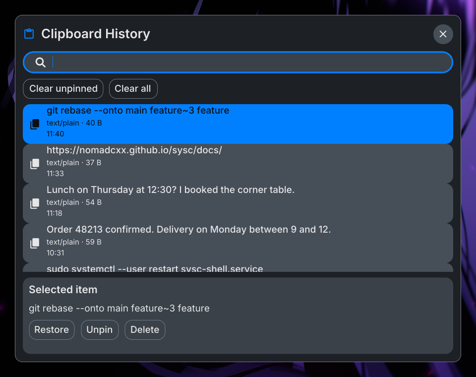
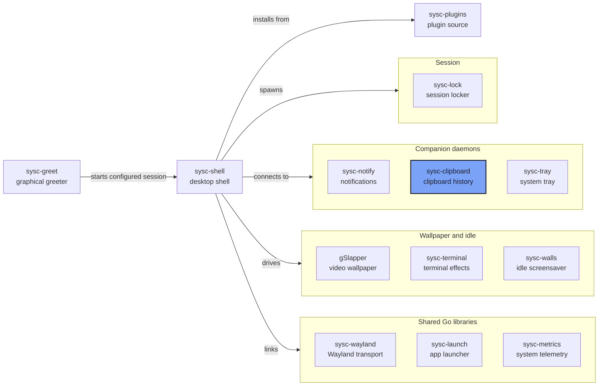

<p align="center">
  <picture>
    <source media="(prefers-color-scheme: dark)" srcset="assets/wordmark.png">
    
  </picture>
</p>

Clipboard history for sysc-shell, with encrypted storage and a Go client. Captures Wayland
clipboard selections; sysc-shell draws the history panel.

<p align="center">
  <br>
  <sub>The sysc-shell clipboard panel, fed by sysc-clipboard (fixture data).</sub>
</p>

## Quick Links

- [Documentation site](https://nomadcxx.github.io/sysc/docs/components/sysc-clipboard/)
- [Documentation](#documentation)
- [The sysc ecosystem](https://github.com/Nomadcxx/sysc-shell/blob/main/docs/ecosystem.md)

## Installation

### Requirements

A compositor with data-control and a Secret Service provider (or `--key-file`).
Source builds need Go 1.26+.

### Guided installer (recommended)

Use the [SYSC Go installer](https://github.com/Nomadcxx/sysc#install) to set up
the shell, its companions and your Niri session together.

### AUR

On Arch, install [sysc-clipboard](https://aur.archlinux.org/packages/sysc-clipboard) with
your AUR helper:

```sh
yay -S sysc-clipboard
systemctl --user enable --now sysc-clipboard.service
```

Encrypted persistence needs a running Secret Service provider, such as
gnome-keyring or KeePassXC, or a configured `--key-file`.

[Documentation](https://nomadcxx.github.io/sysc/docs/).

### From source

```bash
git clone https://github.com/Nomadcxx/sysc-clipboard
cd sysc-clipboard
go build -o ~/.local/bin/sysc-clipboard ./cmd/sysc-clipboard
export PATH="$HOME/.local/bin:$PATH"
```

Or:

```bash
GOBIN="$HOME/.local/bin" go install github.com/Nomadcxx/sysc-clipboard/cmd/sysc-clipboard@latest
export PATH="$HOME/.local/bin:$PATH"
```

### Source builds: user service

```bash
install -Dm644 contrib/sysc-clipboard.service ~/.config/systemd/user/sysc-clipboard.service
systemctl --user daemon-reload
systemctl --user enable --now sysc-clipboard.service
```

## Usage

sysc-clipboard has no interface of its own; sysc-shell draws the history. To inspect persistence and runtime configuration:

```bash
sysc-clipboard --check
```

It prints the state directory, socket, entry count, persistence mode (`durable`, `volatile` or
`unavailable`), capture mode, active history caps and retention settings, then exits 0 or 1 without
starting the daemon. It does not connect to a running daemon or check Wayland availability. Invalid
arguments exit 2. The check never changes history, even when a startup clear is configured.

| Flag | Meaning |
|---|---|
| `--check` | Print state and exit |
| `--key-file <path>` | Use a key file instead of the Secret Service |
| `--state-dir <path>` | Override the state directory (must be absolute) |
| `--disable-capture` | Stop adding clipboard entries while keeping copy and existing history available |
| `--auto-clear-days <n>` | Remove unpinned entries older than this many days (default: 30; 0 disables it) |
| `--clear-at-startup` | Clear all history, including pinned entries, whenever the daemon starts |
| `--max-entries <n>` | Maximum retained entries (default and ceiling: 100) |
| `--max-total-bytes <n>` | Maximum combined payload bytes (default and ceiling: 268435456) |
| `--max-text-bytes <n>` | Maximum bytes in a text entry (default and ceiling: 4194304) |
| `--max-image-bytes <n>` | Maximum bytes in an image entry (default and ceiling: 33554432) |

Set positive lower values in the user-service override to reduce these caps. Byte flags use decimal
bytes. The daemon removes unpinned entries that exceed a lower per-entry cap and evicts the oldest
unpinned entries to meet count and total-byte caps. Pinned entries remain. If they alone exceed a cap,
new captures are rejected until you unpin or remove enough entries. `--check` prints the active values.

To pause history capture while keeping clipboard copy active, run
`systemctl --user edit sysc-clipboard.service` and append `--disable-capture` to its `ExecStart`.
For source installs, use this override:

```ini
[Service]
ExecStart=
ExecStart=%h/.local/bin/sysc-clipboard --disable-capture
```

Reload and restart the service to apply the flag:

```sh
systemctl --user daemon-reload
systemctl --user restart sysc-clipboard.service
```

Use the executable path from your installed unit. Remove the flag and restart the service to resume
history capture. Existing encrypted history remains available while capture is disabled.

The state directory is `$XDG_STATE_HOME/sysc-clipboard`, falling back to
`~/.local/state/sysc-clipboard`.

Unpinned entries are removed after 30 days by default. The daemon applies the age limit at startup
and checks hourly while running; each day is 24 hours. Pinned entries are kept. To keep entries for
7 days instead, add `--auto-clear-days=7` to the user-service override. Set the value to `0` to
keep unpinned entries until the count or size caps evict them. For a source install, the override
is:

```ini
[Service]
ExecStart=
ExecStart=%h/.local/bin/sysc-clipboard --auto-clear-days=7
```

Versions before this default kept entries indefinitely. The first start after an upgrade removes
unpinned entries older than 30 days unless the override sets another value.

To clear the whole history on every daemon start, add `--clear-at-startup`. This also removes pinned
entries and is disabled by default. The daemon exits with an error if encrypted persistence is
unavailable or it cannot save the clear. `--check` reports persistence. The override is:

```ini
[Service]
ExecStart=
ExecStart=%h/.local/bin/sysc-clipboard --clear-at-startup
```

`--check` reports both settings without applying either cleanup.

To lower the caps, add the flags to the same service override. This keeps at most 50 entries and
128 MiB of payload data:

```ini
[Service]
ExecStart=
ExecStart=%h/.local/bin/sysc-clipboard --max-entries=50 --max-total-bytes=134217728
```

## Clients

Run inside an existing Go module:

```bash
go get github.com/Nomadcxx/sysc-clipboard/client
```

The client package offers `Copy`, `Restore`, `Pin`, `Delete`, `DeleteMany`, `Clear`, `Thumbnail` and
`Resync`, plus an `Updates()` stream of snapshots, deltas and command responses. `DeleteMany` checks
for the daemon's `delete-many` capability and returns `client.ErrDeleteManyUnsupported` when the
daemon lacks it. Single-entry deletion remains available.

## History and storage

- **100 entries, 256 MiB total**: text up to 4 MiB and images up to 32 MiB per entry
- **Restores with the captured MIME type**, plus plain-text aliases for text
- **Strips terminal control characters** from text at capture and restore; tab, line feed and
  carriage return are kept
- **Pins**: pinned entries survive `ClearUnpinned` and sort first; `ClearAll` removes them
- **Encrypted at rest**: AES-256-GCM per entry plus an encrypted manifest, with the key in the
  Secret Service or a key file
- **Survives restarts**: history is loaded from disk on start
- **Private socket**: the wire format carries metadata, 200-byte text previews and PNG thumbnails;
  see [Security model](#security-model) for what a client can do with it
- **`ext-data-control-v1`** with a `zwlr-data-control` fallback
- **Skips selections marked by password managers** (`x-kde-passwordManagerHint`), when the source
  sets the marker; the primary selection is not captured
- **Honours a clear while it owns the selection**; see [Security model](#security-model)
- **Duplicate payloads** merge their MIME types and keep their pin
- **A corrupt manifest is quarantined** and history degrades to volatile instead of failing

## Security model

sysc-clipboard protects history from other users and from offline access to the disk. It does not
protect history from other processes running as the same user. Treat every program in your session
as able to read and change the history.

- **The socket is not an access check.** The daemon accepts any client with your uid. Through
  `restore` and `copy`, a client can put any stored entry, or text of its choice, on the system
  clipboard, where any application can read it. Through `clear` and `delete`, it can destroy history.
  The protocol carries metadata only, but a restore publishes the whole payload to the clipboard.
- **The key can be read by any same-user process.** In the default setup, the history key is a
  Secret Service item in the default collection. Any process on your session bus can look it up
  while the keyring is unlocked and decrypt the state directory. A `--key-file` is readable by the
  same processes.
- **The client checks the daemon's uid, not its identity.** Clients refuse a socket served by
  another user. A process of the same user can replace the socket and show a client false entries
  and false acknowledgements.
- **The password-manager marker is optional.** The daemon skips a selection only when its source
  adds `x-kde-passwordManagerHint`. Password managers without the marker, `wl-copy`, terminals and
  most other tools are captured in full. When you copy secrets regularly, use a short
  `--auto-clear-days`, or pause history with `--disable-capture` while you handle them.
- **One clear can be undone once.** When the application that owns the clipboard exits, the daemon
  offers the last copy again, so a paste still works after the source is closed. Wayland reports a
  clear in the same way as an exit, so the daemon also re-offers after a clear of a selection it
  does not own. A second clear removes it, because the daemon then owns the selection and honours
  the clear. A clear of a selection the daemon skips, such as one marked by a password manager, is
  never undone. `--disable-capture` pauses history only: the daemon still keeps the current
  selection in memory and re-offers it once after a clear.

## Ecosystem



[The sysc ecosystem](https://github.com/Nomadcxx/sysc-shell/blob/main/docs/ecosystem.md) explains
each connection, socket and version pin.

## Documentation

- [The sysc ecosystem](https://github.com/Nomadcxx/sysc-shell/blob/main/docs/ecosystem.md)
- [sysc-shell](https://github.com/Nomadcxx/sysc-shell) — the shell that draws the clipboard panel

## License

BSD-3-Clause.

---

<a href="https://github.com/Nomadcxx"></a> — terminal-native tooling for the linux desktop.
[More projects →](https://github.com/Nomadcxx) · [Sponsor](https://github.com/sponsors/Nomadcxx) ❤️
